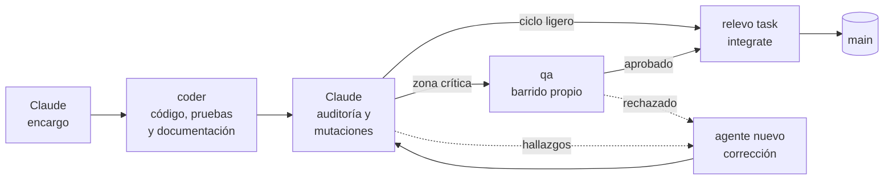

<div align="center">

# relevo

**Delegación y auditoría de agentes de código para Claude Code**

Claude planifica y audita. Agentes de otros proveedores implementan en worktrees aislados con permisos acotados por rol.<br>
Nada llega a la rama principal sin verificación independiente.

[](https://github.com/CrisAcalo/relevo/actions/workflows/pruebas.yml)


[](LICENSE)

[Inicio rápido](#inicio-rápido) · [Cómo funciona](#cómo-funciona) · [Seguridad](#seguridad) · [Documentación](#documentación)

</div>

---

## Por qué relevo

Los modelos rápidos y económicos, como Gemini Flash, escriben código a gran velocidad. Dejarlos trabajar solos sobre un repositorio, en cambio, es arriesgado: suponen lo que el encargo no dice, escriben pruebas que no prueban nada y, con permisos amplios, pueden tocar lo que no deben.

relevo reparte el trabajo como una carrera de relevos:
- **Claude Code** dirige: escribe encargos precisos, audita cada entrega e integra.
- **Los agentes** implementan, documentan y hacen QA, cada uno en su carril. Hoy son agentes de Antigravity CLI `agy`, y hay un adaptador para OpenAI Codex.

Quien escribe el código nunca emite el veredicto.

## Características

- **Worktrees por tarea**: cada agente trabaja en su propio worktree y su propia rama, sin tocar el árbol principal. Varias tareas independientes avanzan en paralelo.
- **Permisos por rol**: una puerta de permisos intercepta cada herramienta y comando. Deniega git de escritura, dependencias, red, borrados recursivos y `Start-Process`, incluidas sus variantes (`npm.cmd install`, `git -C . commit`, `& "git.exe" push`…). También limita qué archivos puede editar cada rol.
- **QA independiente con mutaciones**: un agente distinto rompe el código, siempre en una copia, para comprobar que las pruebas lo detectan. Después emite un veredicto con esquema estricto atado al parche.
- **Ciclo proporcional al riesgo**: los cambios acotados se integran tras la auditoría; las zonas críticas pasan además por QA.
- **Git en un solo comando**: `relevo task integrate` rebasa si hace falta, ejecuta las pruebas, pasa la definición de hecho, integra y limpia. Un rebase sin conflictos conserva el veredicto.
- **Definición de hecho mecánica**: `relevo check` impide integrar sin pruebas, sin veredicto válido o con la documentación desactualizada.
- **Agentes en segundo plano, a la vista**: `relevo watch` muestra en vivo qué hace cada agente, cuánto tarda y cuántos tokens consume.
- **Sin dependencias**: solo Node.js. Probado en CI en Windows y Linux.

## Cómo funciona



1. **Encargo.** Claude redacta una especificación cerrada: archivos exactos, contratos, invariantes y pruebas que deben fallar sin el cambio.
2. **Implementación.** Un agente `coder` escribe código, pruebas y documentación en su worktree, en segundo plano.
3. **Auditoría.** Claude no confía en el resumen del agente. Lee el diff, ejecuta las pruebas, rompe el código a propósito para comprobar que las pruebas lo detectan y hace su propio barrido. Cada corrección va a un agente nuevo.
4. **QA**, solo en zonas críticas. Un agente `qa` independiente intenta demostrar que el cambio está mal y escribe `.qa-verdict.json`.
5. **Integración.** `relevo task integrate` comprueba todo e integra por fast-forward, sin pedir aprobación cuando el ciclo se cumple.

El procedimiento completo está en la [decisión 02](docs/decisions/02-flujo-claude-agentes.md) y en la skill [`delegar-agy`](templates/skills/delegar-agy/SKILL.md).

## Inicio rápido

**Requisitos:** Node.js ≥ 22.12, git, Claude Code y Antigravity CLI (`agy`).

```bash
# 1. Instala relevo
git clone https://github.com/CrisAcalo/relevo.git
cd relevo && npm link

# 2. Instálalo en tu proyecto y comprueba el entorno
cd ../mi-proyecto
relevo init
relevo doctor
```

> [!TIP]
> **Si `relevo` no se encuentra tras `npm link`**, la carpeta global de npm no está en el PATH. Ocurre con algunos gestores de versiones de Node, como nvm para Windows. Comprueba `npm prefix -g`, abre una terminal nueva o vuelve a seleccionar la versión con tu gestor (por ejemplo `nvm use <versión>`). Mientras tanto, funciona igual con `node <ruta-a-relevo>/bin/relevo.cjs <comando>`.

¿Tu proyecto ya tenía una copia del flujo de agentes? Sigue [Migrar desde una copia incrustada](docs/configuracion.md#migrar-desde-una-copia-incrustada).

`relevo init` añade al proyecto un `relevo.config.json` vacío, las skills de Claude Code, los agentes `qa` y `documentalista` y la puerta de permisos. Después:

1. Rellena los marcadores `<<PROYECTO: …>>` de las plantillas, sobre todo las **zonas críticas** de `delegar-agy`, que deciden qué tareas pasan por QA.
2. En `relevo.config.json`, configura solo lo que difiera de los valores por defecto. Como mínimo, `check.testCommand`, para que `task integrate` ejecute tus pruebas.
3. Aplica la [configuración global de agy](templates/agy-settings.example.md).

Detalles en [Configuración](docs/configuracion.md).

**Una tarea de principio a fin:**

```bash
relevo task new mi-tarea                  # worktree y rama relevo/mi-tarea

relevo run --provider agy --role coder \
  --model gemini-3.8-flash-high \
  --task mi-tarea --cwd .worktrees/mi-tarea \
  --brief encargos/mi-tarea.md            # lanza el agente en segundo plano

relevo watch                              # síguelo en vivo

relevo task integrate mi-tarea            # rebase, pruebas, check, fast-forward y limpieza
```

Para actualizar relevo en un proyecto: `git pull` en el clon de relevo y `relevo update --apply` en el proyecto. Las skills que hayas personalizado no se tocan: la plantilla nueva queda al lado como `.relevo-new`.

### Comandos

| Comando | Descripción |
|---|---|
| `relevo init` | Instala configuración, plantillas y puerta de permisos en el proyecto. |
| `relevo doctor` | Comprueba el entorno, la configuración global de agy y la instalación. |
| `relevo task new \| integrate \| done \| list` | Crea, integra, cierra y lista tareas con su worktree. |
| `relevo run` | Lanza un agente con proveedor, rol, modelo y encargo. |
| `relevo watch` | Panel en vivo de los agentes. |
| `relevo quota` | Cupos restantes del proveedor, sin consumir tokens. |
| `relevo check` | Control mecánico de la definición de hecho. |
| `relevo update` | Actualiza lo instalado sin pisar lo que personalizaste. |

Opciones y comportamiento de cada comando en la [referencia de comandos](docs/comandos.md).

## Seguridad

relevo protege en dos capas:

1. **Configuración global de agy**, que aplica el usuario: `toolPermission: "always-proceed"`, para que el agente avance sin aprobaciones manuales, y reglas `deny` mínimas. `relevo doctor` comprueba que estén.
2. **Puerta de permisos del repositorio**: un hook `PreToolUse`.
   - Deniega a todos los roles git de escritura, cambios de dependencias, red, borrados recursivos, ejecución dinámica, `Start-Process`, navegadores visibles y rutas sensibles.
   - Cada regla se comprueba sobre el comando tal cual y sobre su **forma canónica**: sin extensiones `.exe` y `.cmd`, sin opciones globales de git y sin comillas.
   - Limita las rutas editables por rol: QA no puede editar código.
   - Registra cada decisión en `.agents/hooks/gate.log`.

Además, ningún lanzador añade flags que desactiven permisos o sandbox, y las claves de los proveedores viven solo en variables de entorno.

> [!IMPORTANT]
> La puerta analiza el texto de comandos y rutas; **no es un sandbox de sistema operativo**. Está pensada para acotar agentes y prevenir errores en repositorios de confianza, junto con el aislamiento del worktree y la auditoría de Claude.

Cada regla tiene documentado qué protege y qué incidente real la motivó: [por qué existe cada regla](docs/por-que-cada-regla.md).

## Construido con relevo

relevo se desarrolla con su propio flujo. Claude Code planifica, redacta los encargos y audita; agentes `agy` con Gemini 3.8 Flash High escriben el código y hacen QA.

| | |
|---|---|
| Ejecuciones de agentes | **52**: 32 de código, 17 de QA y 3 de documentación e investigación |
| Tiempo de agente | **6,2 h**, varias tareas en paralelo |
| Tokens de Gemini Flash | **8,7 M** |
| Pruebas | **178** en 12 suites, en Windows y Linux |

Lo que la verificación independiente encontró y las pruebas de los agentes no:
- **QA rechazó entregas por fallos reales.**
  - `git branch --delete` se permitía como lectura.
  - Un `node_modules` con seguimiento se ocultaba a `check`.
  - `cmd /k start` esquivaba la regla de `Start-Process`.
- **La auditoría de Claude** detectó pruebas que no fallaban con el código roto y añadió los casos que faltaban. También vio que `update` habría ofrecido la misma plantilla para siempre ([R-03](docs/incidentes.md#r-03--update-habría-ofrecido-la-misma-plantilla-para-siempre-auditoría-2026-11-10)).
- **El CI**, en su primera ejecución, encontró que `check` fallaba en Linux con el enlace `node_modules` de los worktrees. En Windows no se veía.
- **Instalarlo en un proyecto real**, como lo haría un usuario nuevo, destapó seis tropiezos de `init`, `doctor`, `check` y la documentación, ya corregidos.

El flujo nació en el proyecto «Procedural // Studio», que hoy usa relevo como herramienta ([decisión 01](docs/decisions/01-origen-y-alcance.md)). Cada fallo y su regla están en el [registro de incidentes](docs/incidentes.md).

## Documentación

| Documento | Contenido |
|---|---|
| [Comandos](docs/comandos.md) | Referencia completa de cada comando y del formato del veredicto de QA. |
| [Configuración](docs/configuracion.md) | Qué instala `init`, `relevo.config.json`, el ámbito de cada rol y cómo migrar desde una copia incrustada. |
| [Por qué existe cada regla](docs/por-que-cada-regla.md) | Qué protege cada regla y su origen. Léelo antes de relajar una. |
| [Registro de incidentes](docs/incidentes.md) | Fallos reales, con síntoma, causa y regla resultante. |
| [Decisión 01 · Origen, alcance y nombre](docs/decisions/01-origen-y-alcance.md) | De dónde sale relevo y qué se generalizó. |
| [Decisión 02 · Flujo Claude + agentes](docs/decisions/02-flujo-claude-agentes.md) | El ciclo de una tarea, roles, autonomía y ciclo proporcional. |

## Estado

relevo está en **0.2.0**, en uso real y sin publicar en npm.

| Proveedor | Estado |
|---|---|
| Antigravity CLI (`agy`) | Validado en uso real con Gemini Flash High y Argon. El encargo viaja por stdin, sin límite de longitud. |
| OpenAI Codex CLI (`codex`) | Lanzamiento y lectura de eventos validados con una ejecución real. El modelo debe indicarse con `--model` y depende del tipo de cuenta. |

**Novedades de 0.2.0:**
- `relevo task integrate` y el ciclo proporcional.
- Veredicto válido tras un rebase con el mismo parche.
- Forma canónica de comandos en la puerta y `Start-Process` denegado.
- QA muta copias, nunca el código.
- `relevo task done` retoma cierres interrumpidos y `watch` marca las ejecuciones interrumpidas.
- `relevo check` funciona en Linux y en ramas sin commits.
- CI en Windows y Linux.

## Desarrollo

```bash
npm test                    # en Windows: npm.cmd test
node bin/relevo.cjs check
```

El código es CommonJS sin dependencias de terceros: solo módulos `node:`. Los cambios siguen el propio flujo de relevo. Las convenciones están en [CLAUDE.md](CLAUDE.md).

## Licencia

[MIT](LICENSE) © 2026 Cristian Acalo
