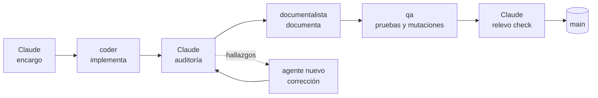

<div align="center">

# relevo

**Delegación y auditoría de agentes de código para Claude Code**

Claude planifica y audita. Agentes de otros proveedores implementan en worktrees aislados con permisos acotados por rol.<br>
Nada llega a la rama principal sin verificación independiente.


[](LICENSE)

[Inicio rápido](#inicio-rápido) · [Cómo funciona](#cómo-funciona) · [Seguridad](#seguridad) · [Documentación](#documentación)

</div>

---

## Por qué relevo

Los modelos rápidos y económicos, como Gemini Flash, escriben código a gran velocidad, pero dejarlos trabajar solos sobre un repositorio es arriesgado: suponen lo que el encargo no dice, escriben pruebas que no prueban nada y, con permisos amplios, pueden tocar lo que no deben.

relevo reparte el trabajo como una carrera de relevos. **Claude Code** dirige: escribe encargos precisos, audita cada entrega y hace los commits. **Los agentes** (hoy Antigravity CLI `agy`, con un adaptador para OpenAI Codex) implementan, documentan y hacen QA, cada uno en su carril. Quien escribe el código nunca emite el veredicto.

## Características

- **Worktrees por tarea**: cada agente trabaja en su propio worktree y su propia rama; el árbol principal no se toca.
- **Permisos por rol**: una puerta de permisos intercepta cada herramienta y comando. Deniega git de escritura, dependencias, red y borrados recursivos, y limita qué archivos puede editar cada rol.
- **QA independiente con mutaciones**: un agente distinto rompe el código a propósito para comprobar que las pruebas lo detectan, y emite un veredicto con esquema estricto atado al commit.
- **Definición de hecho mecánica**: `relevo check` impide integrar sin pruebas, sin veredicto válido o con la documentación desactualizada.
- **Agentes en segundo plano, a la vista**: `relevo watch` muestra en vivo qué hace cada agente, cuánto tarda y cuántos tokens consume.
- **Control de cupos**: `relevo quota` consulta el cupo sin gastar tokens, y `relevo run` no lanza agentes que se quedarían a medias.
- **Sin dependencias**: solo Node.js; funciona igual en Windows, Linux y macOS.

## Cómo funciona



1. **Encargo.** Claude redacta una especificación cerrada: archivos exactos, contratos, invariantes y pruebas que deben fallar sin el cambio.
2. **Implementación.** Un agente `coder` trabaja en segundo plano en su worktree.
3. **Auditoría.** Claude no confía en el resumen del agente: lee el diff, ejecuta las pruebas y hace su propio barrido. Cada corrección va a un agente nuevo con un encargo preciso.
4. **Documentación.** Un agente `docs` actualiza la documentación a partir del diff real.
5. **QA.** Un agente `qa` ejecuta las suites, aplica mutaciones y escribe `.qa-verdict.json`.
6. **Integración.** `relevo check` valida el ciclo y Claude integra en la rama principal.

El procedimiento completo está en la [decisión 02](docs/decisions/02-flujo-claude-agentes.md) y en la skill [`delegar-agy`](templates/skills/delegar-agy/SKILL.md).

## Inicio rápido

**Requisitos:** Node.js ≥ 22.12, git, Claude Code y Antigravity CLI (`agy`).

```bash
# 1. Instala relevo
git clone https://github.com/CrisAcalo/relevo.git
cd relevo && npm link

# 2. Instálalo en tu proyecto y comprueba el entorno
cd ../mi-proyecto
relevo init
relevo doctor
```

`relevo init` añade al proyecto la configuración, las skills de Claude Code, los agentes `qa` y `documentalista` y la puerta de permisos. Después, rellena los marcadores `<<PROYECTO: …>>` de las plantillas y aplica la [configuración global de agy](templates/agy-settings.example.md). Detalles en [Configuración](docs/configuracion.md).

**Una tarea de principio a fin:**

```bash
relevo task new mi-tarea                  # worktree y rama relevo/mi-tarea

relevo run --provider agy --role coder \
  --model gemini-3.8-flash-high \
  --task mi-tarea --cwd .worktrees/mi-tarea \
  --brief encargos/mi-tarea.md            # lanza el agente en segundo plano

relevo watch                              # síguelo en vivo
relevo check                              # definición de hecho, tras la auditoría y QA
relevo task done mi-tarea                 # limpia el worktree una vez integrado
```

### Comandos

| Comando | Descripción |
|---|---|
| `relevo init` | Instala configuración, plantillas y puerta de permisos en el proyecto. |
| `relevo doctor` | Comprueba el entorno, la configuración global de agy y la instalación. |
| `relevo task new \| done \| list` | Crea, cierra y lista worktrees de tarea. |
| `relevo run` | Lanza un agente con proveedor, rol, modelo y encargo. |
| `relevo watch` | Panel en vivo de los agentes. |
| `relevo quota` | Cupos restantes del proveedor, sin consumir tokens. |
| `relevo check` | Control mecánico de la definición de hecho. |
| `relevo update` | Actualiza lo instalado sin pisar lo que personalizaste. |

Opciones y comportamiento de cada comando en la [referencia de comandos](docs/comandos.md).

## Seguridad

relevo protege en dos capas:

1. **Configuración global de agy**, que aplica el usuario: `toolPermission: "always-proceed"` para que el agente avance sin aprobaciones manuales, y reglas `deny` mínimas. `relevo doctor` comprueba que estén.
2. **Puerta de permisos del repositorio**: un hook `PreToolUse` que deniega a todos los roles git de escritura, cambios de dependencias, red, borrados recursivos, ejecución dinámica, navegadores visibles y rutas sensibles, y que limita las rutas editables por rol. Registra cada decisión en `.agents/hooks/gate.log`.

Además, ningún lanzador añade flags que desactiven permisos o sandbox, y las claves de los proveedores viven solo en variables de entorno.

> [!IMPORTANT]
> La puerta analiza el texto de comandos y rutas; **no es un sandbox de sistema operativo**. Está pensada para acotar agentes y prevenir errores en repositorios de confianza, junto con el aislamiento del worktree y la auditoría de Claude.

Cada regla tiene documentado qué protege y qué incidente real la motivó: [por qué existe cada regla](docs/por-que-cada-regla.md).

## Construido con relevo

relevo se ha desarrollado con su propio flujo. Claude Code planificó, redactó los encargos y auditó; seis agentes `agy` con Gemini 3.8 Flash High escribieron el código, lanzados por parejas en paralelo:

| Ejecución | Encargo | Duración | Tokens |
|---|---|---:|---:|
| `01-relevo-config` | Configuración, política y `check` parametrizados; `init` | 17 min | 383k |
| `02-relevo-plantillas` | Plantillas genéricas de skills y agentes | 9 min | 220k |
| `03-task-update` | `task` y `update` | 10 min | 363k |
| `04-doctor-veredicto` | `doctor` y esquema estricto del veredicto | 11 min | 280k |
| `05-update-base` | Corrección: fusión a tres bandas en `update` | 7 min | 158k |
| `06-doctor-gitignore` | Corrección: `doctor` con `git check-ignore` | 6 min | 189k |
| | **Total** | **≈ 1 h** | **1,6 M** |

Las dos últimas son rondas de corrección. La auditoría de Claude detectó, leyendo el código, que `update` habría ofrecido la misma plantilla para siempre ([incidente R-03](docs/incidentes.md#r-03--update-habría-ofrecido-la-misma-plantilla-para-siempre-auditoría-2026-11-10)) y que `doctor` daba avisos falsos. Ninguno de los dos fallos lo detectaban las pruebas del agente.

El flujo nació antes, en el proyecto «Procedural // Studio», donde se validó con tareas reales de código, QA E2E, investigación y análisis de capturas ([decisión 01](docs/decisions/01-origen-y-alcance.md)).

## Documentación

| Documento | Contenido |
|---|---|
| [Comandos](docs/comandos.md) | Referencia completa de cada comando y del formato del veredicto de QA. |
| [Configuración](docs/configuracion.md) | Qué instala `init`, `relevo.config.json` y el ámbito de cada rol. |
| [Por qué existe cada regla](docs/por-que-cada-regla.md) | Qué protege cada regla y su origen. Léelo antes de relajar una. |
| [Registro de incidentes](docs/incidentes.md) | Fallos reales, con síntoma, causa y regla resultante. |
| [Decisión 01 · Origen, alcance y nombre](docs/decisions/01-origen-y-alcance.md) | De dónde sale relevo y qué se generalizó. |
| [Decisión 02 · Flujo Claude + agentes](docs/decisions/02-flujo-claude-agentes.md) | El ciclo de una tarea, roles y definición de hecho. |

## Estado

relevo está en **0.1.0**, en desarrollo activo y sin publicar en npm.

| Proveedor | Estado |
|---|---|
| Antigravity CLI (`agy`) | Validado en uso real con Gemini Flash High y Argon. |
| OpenAI Codex CLI (`codex`) | Adaptador implementado y probado con eventos sintéticos; falta validarlo con una ejecución real. |

## Desarrollo

```bash
npm test                    # en Windows: npm.cmd test
node bin/relevo.cjs check
```

El código es CommonJS sin dependencias de terceros: solo módulos `node:`. Los cambios siguen el propio flujo de relevo. Convenciones en [CLAUDE.md](CLAUDE.md).

## Licencia

[MIT](LICENSE) © 2026 Cristian Acalo
